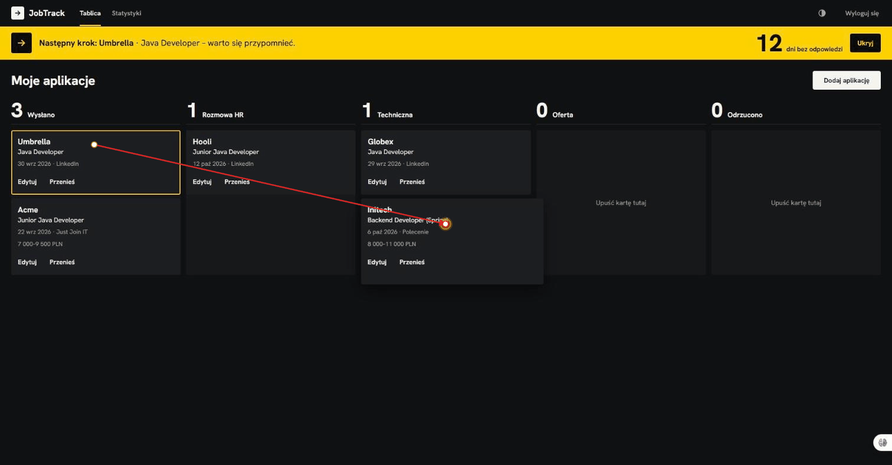

# JobTrack

Tracker procesów rekrutacyjnych: tablica Kanban z etapami aplikacji o pracę, przypomnienia o follow-upie
i prosta analityka skuteczności. Mały projekt, ale domknięty: testy, CI, Swagger i uruchomienie jedną komendą.



## Uruchomienie

Wymagany tylko Docker.

```bash
docker compose up --build
```

- Aplikacja: http://localhost:8000 (załóż konto na ekranie logowania)
- Swagger UI: http://localhost:8000/swagger-ui.html: zaloguj się przez `POST /api/auth/login`, kliknij **Authorize** i wklej token

Sekret JWT ma w `docker-compose.yml` wartość domyślną do lokalnego demo. Poza swoją maszyną ustaw go w pliku `.env`:

```
JWT_SECRET=<co najmniej 32 losowe znaki>
DB_PASSWORD=<hasło do bazy>
```

## Funkcje

- **Konta użytkowników**: rejestracja i logowanie (JWT). Każdy widzi wyłącznie swoje dane.
- **Aplikacje**: firma, stanowisko, link do oferty, widełki, źródło (LinkedIn, Just Join IT, polecenie), data wysłania.
- **Notatki i historia etapów**: każda aplikacja ma listę datowanych notatek oraz oś czasu zmian etapu.
- **Kanban**: `WYSLANO → ROZMOWA_HR → TECHNICZNA → OFERTA / ODRZUCONO`, zmiana statusu przez drag & drop
  albo z menu „Przenieś” (klawiatura, dotyk). Każda zmiana zapisuje wpis w historii (`status_change`).
- **Przypomnienia**: aplikacja w statusie `WYSLANO` dłużej niż 7 dni (`jobtrack.reminders.after-days`)
  dostaje przypomnienie o follow-upie, widoczne nad tablicą.
- **Statystyki**: aplikacje na tydzień (8 tygodni), % aplikacji z odpowiedzią, średni czas do pierwszej
  odpowiedzi, skuteczność według źródła.
- **Motyw jasny / ciemny / systemowy** z przełącznikiem w górnym pasku i **widok na telefon**
  (jedna kolumna naraz z przełącznikiem etapów, dialog na pełny ekran).

## Stack

| Warstwa  | Technologie |
|----------|-------------|
| Backend  | Java 21, Spring Boot 4, Spring Data JPA, Spring Security (OAuth2 Resource Server, JWT HS256), Bean Validation, Flyway, springdoc-openapi, Maven |
| Baza     | PostgreSQL 17 |
| Frontend | Angular 22 (standalone components, signals), Angular Material, CDK Drag & Drop, ng2-charts |
| Testy    | JUnit 5, Mockito, AssertJ, Testcontainers (PostgreSQL), MockMvc; Vitest po stronie Angulara |
| Infra    | Docker Compose (Postgres + backend + nginx), GitHub Actions |

## Architektura i decyzje

```
backend/src/main/java/pl/unkx/jobtrack/
├── auth/            rejestracja, logowanie, konfiguracja Spring Security i JWT
├── user/            encja User
├── jobapplication/  CRUD aplikacji, zmiana statusu, historia StatusChange, notatki
├── reminder/        zadanie @Scheduled i API przypomnień
└── stats/           statystyki liczone z historii statusów
frontend/src/app/
├── core/            AuthService, interceptor z tokenem, guardy tras
├── login/  board/  stats/
└── applications/  reminders/   serwisy HTTP i modele
```

- **Jeden monolit, pakiety według funkcji.** W każdym pakiecie warstwy controller → service → repository,
  a na granicy API rekordy DTO. Mikroserwisy, kolejki i Kubernetes byłyby przy tej skali tylko kosztem.
- **Schemat bazy wyłącznie przez Flyway** (`V1`–`V5`). Hibernate działa w trybie `ddl-auto: validate`,
  więc rozjazd między encją a migracją wywala start aplikacji, a nie produkcję. `open-in-view` jest wyłączone.
- **JWT bez dodatkowej biblioteki.** Token wystawia i weryfikuje Spring Security OAuth2 Resource Server
  (Nimbus, HS256). Sesje są bezstanowe, hasła trzymane jako BCrypt.
- **Izolacja danych w zapytaniach.** Każde zapytanie jest filtrowane po `userId` z tokenu. Cudzy rekord
  zwraca 404, a nie 403, żeby nie zdradzać, że istnieje.
- **Statystyki z historii, nie z bieżącego stanu.** Aplikacja „dostała odpowiedź”, jeśli ma jakąkolwiek
  zmianę statusu. Czas do odpowiedzi liczy się do pierwszej zmiany, a oferta to dowolne przejście do `OFERTA`.
  Cofnięcie karty na tablicy nie fałszuje więc wyników.
- **Przypomnienia idempotentne.** Zadanie `@Scheduled` (start po 10 s, potem co godzinę) wykonuje jedno
  zapytanie `INSERT … SELECT … ON CONFLICT DO NOTHING`. Każda aplikacja dostaje najwyżej jedno przypomnienie,
  nawet gdy dwa przebiegi się nałożą. Przypomnienie znika, gdy aplikacja opuści status `WYSLANO`.
- **Czas wstrzykiwany jako `Clock`**, dzięki czemu statystyki są testowane na stałych datach.
- **Jedno origin.** nginx serwuje Angulara i przekazuje `/api` oraz Swaggera do backendu, a w trybie
  deweloperskim robi to proxy `ng serve`. Nie ma potrzeby konfigurować CORS.
- **Jeden zestaw tokenów kolorów** (`light-dark()` w `styles.scss`) przestylowuje komponenty Material
  w obu motywach. Żółty jest zarezerwowany dla wskazówek „co dalej”; system wizualny opisuje `DESIGN.md`.

## Testy

```bash
cd backend && ./mvnw verify        # Windows: .\mvnw.cmd verify (wymaga uruchomionego Dockera)
cd frontend && npm test -- --watch=false
```

- **Backend (34 testy):**
  - testy endpointów na prawdziwym PostgreSQL w Testcontainers: autoryzacja (401/200, cudze dane → 404),
    CRUD, walidacja, historia statusów, notatki, przypomnienia, statystyki, dokumentacja OpenAPI;
  - testy jednostkowe `StatsService` (Mockito) na znanym zestawie danych.
- **Frontend (34 testy):** interceptor (token, wylogowanie po 401), guard, motyw (domyślnie systemowy,
  zapamiętany wybór), tablica (drag & drop, zmiana etapu z menu, rollback przy błędzie, kolejka przypomnień,
  przełącznik etapów, pusty stan), dialog aplikacji (notatki, historia, potwierdzenie usunięcia) i statystyki.

GitHub Actions (`.github/workflows/ci.yml`) uruchamia testy backendu i frontendu oraz buduje obrazy Dockera.

## Tryb deweloperski

```bash
docker compose up -d postgres                # baza na localhost:5434
cd backend && ./mvnw spring-boot:run         # API na :8080
cd frontend && npm start                     # Angular na :4200, /api przez proxy na :8080
```

## Roadmap

- Eksport aplikacji do CSV
- Wersje CV przypisane do aplikacji
- Automatyczne uzupełnianie danych po wklejeniu linku do oferty
